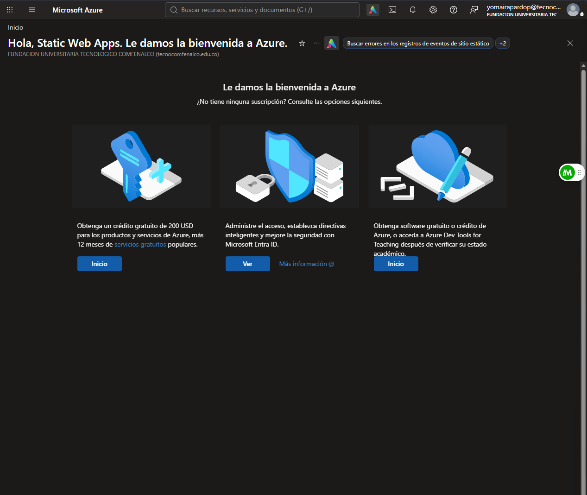
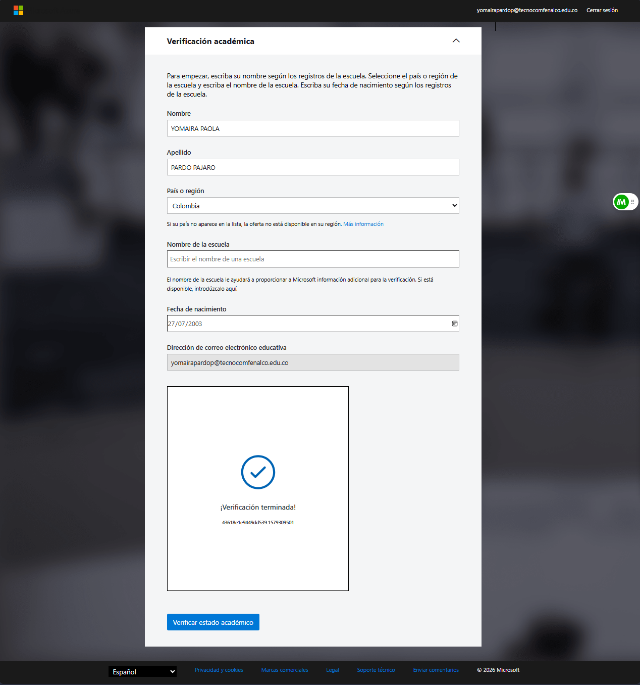
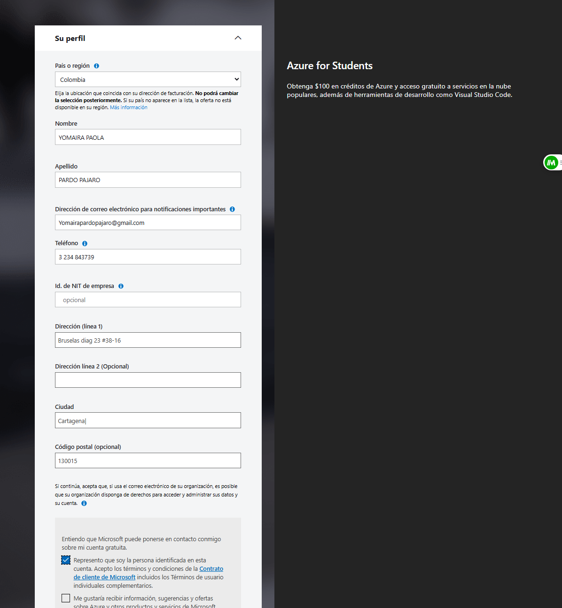
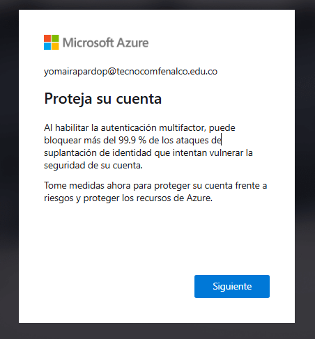
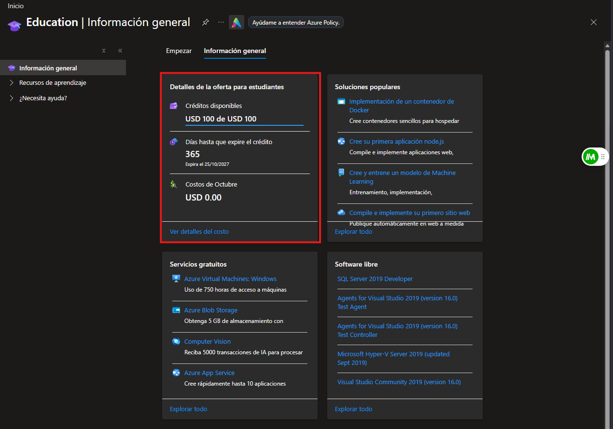
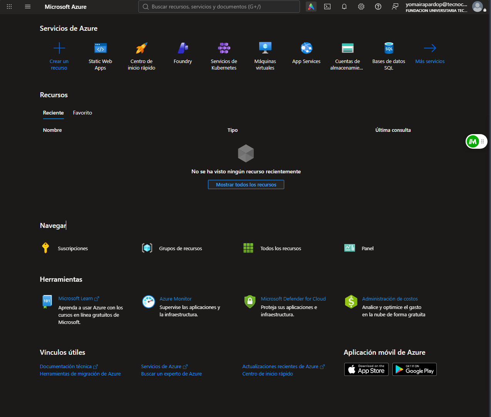

  

<h1 align="center">Pokédex en Azure</h1>

  
  
  

  <a href="PEGA-AQUI-TU-URL">Ver la app en vivo</a> ·
  <a href="Despliegue.md">Cómo la desplegué</a>

---

# Tutorial: creación de la cuenta en la nube pública (Azure)

**Autora:** Yomaira Pardo
**Laboratorio:** Despliegue de la aplicación PokeDex (Pueblo Paleta Inc.)
**Nube pública utilizada:** Microsoft Azure (servicio Azure Static Web Apps)
**Repositorio:** https://github.com/JomiJoestar/pokedex

Este documento explica, paso a paso, cómo se creó y configuró la cuenta en la nube pública utilizada para el despliegue. El procedimiento de despliegue de la aplicación está en [Despliegue.md](Despliegue.md).

---

## 1. Resumen

Se eligió **Microsoft Azure** entre las opciones del laboratorio. Primero se activó la oferta **Azure for Students** con el correo institucional. Esa suscripción impidió crear el servicio Static Web Apps por una política de regiones (el detalle está en la sección de problemas de [Despliegue.md](Despliegue.md)), por lo que se creó además una **cuenta gratuita de Azure** con otro correo, que fue la usada para el despliegue final.

| Elemento | Detalle |
|---|---|
| Plataforma | Microsoft Azure |
| Servicio | Azure Static Web Apps (plan Free) |
| Primera cuenta | Azure for Students (correo institucional) |
| Cuenta final | Cuenta gratuita de Azure (otro correo), suscripción "Azure subscription 1" |

---

## 2. Conceptos básicos de Azure

Antes de crear la cuenta conviene entender cómo se organiza Azure:

- **Cuenta Microsoft / identidad:** el correo con el que se inicia sesión.
- **Tenant (directorio de Microsoft Entra ID):** el directorio que agrupa las identidades de una organización. Iniciar sesión crea el acceso, pero no da recursos por sí solo.
- **Suscripción:** contenedor de facturación y créditos. Sin suscripción no se puede crear ningún recurso.
- **Grupo de recursos:** carpeta lógica donde se agrupan los recursos de un proyecto. Al borrarlo se borra todo lo que contiene.
- **Recurso:** cualquier servicio creado (en este caso, una Static Web App).
- **Región:** centro de datos donde se aloja el recurso. Algunas suscripciones restringen las regiones permitidas mediante Azure Policy.

---

## 3. Primera cuenta: Azure for Students (correo institucional)

### Paso 1. Primer ingreso al portal

Se ingresó a [portal.azure.com](https://portal.azure.com) con el correo institucional. El portal mostró la pantalla de bienvenida indicando que la cuenta todavía **no tenía ninguna suscripción**: iniciar sesión crea el acceso al directorio, pero la suscripción de estudiante debe activarse aparte. Entre las opciones aparece la de obtener crédito de Azure tras verificar el estado académico.

### Paso 2. Página de Azure for Students

Desde esa opción se llega a la página de Azure for Students ("Cree soluciones en la nube con Azure for Students de forma gratuita"). Se pulsa **Empezar gratis**.

### Paso 3. Verificación académica

Azure solicita verificar el estado de estudiante con el correo de la institución. Se completa el formulario de verificación y se espera la confirmación.

### Paso 4. Perfil y términos

Se completa el perfil con los datos personales y se aceptan los términos de la oferta.

### Paso 5. Protección de la cuenta

Azure sugiere activar la autenticación multifactor para proteger la cuenta. Se continúa con **Siguiente**.

### Paso 6. Panel de educación

Al finalizar se abre el panel de **Education**, que muestra los detalles de la oferta: crédito disponible de USD 100 y 365 días de vigencia.

### Paso 7. Portal de Azure

Desde el portal ya se puede buscar y crear recursos.

---

## 4. Cuenta final: cuenta gratuita de Azure (otro correo)

Al intentar crear la Static Web App con la suscripción de estudiante apareció el error `RequestDisallowedByAzure`: una política limita las regiones donde se pueden crear recursos y ninguna región disponible para Static Web Apps estaba permitida. Los detalles y capturas del error están en [Despliegue.md](Despliegue.md).

Para poder usar el servicio se creó una cuenta gratuita de Azure con otro correo:

1. Abrir una **ventana privada** del navegador, para no mezclar sesiones con la cuenta institucional.
2. Ir a [azure.microsoft.com/free](https://azure.microsoft.com/free) y pulsar **Probar Azure gratis**.
3. Iniciar sesión con la cuenta Microsoft del otro correo.
4. Completar el perfil y la verificación de identidad que solicita Azure.
5. Entrar a [portal.azure.com](https://portal.azure.com), abrir **Suscripciones** y confirmar que aparece **Azure subscription 1** con estado **Activa**.

<!-- Si tomas una captura de la pantalla Suscripciones, guárdala como capturas/34-suscripcion-cuenta-gratuita.png y quita las marcas de comentario de la línea siguiente:

-->

### Control de costos

- Se usó únicamente el plan **Free** de Static Web Apps, que no genera costo.
- No se activaron servicios de pago.
- Al finalizar la evaluación se elimina el grupo de recursos para no dejar nada en ejecución.

---

## 5. Siguiente paso

Con la suscripción activa, el despliegue de la aplicación está documentado en [Despliegue.md](Despliegue.md).
